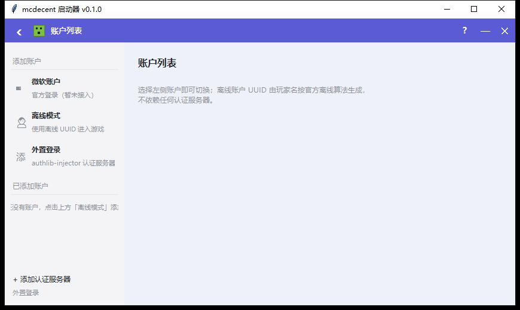
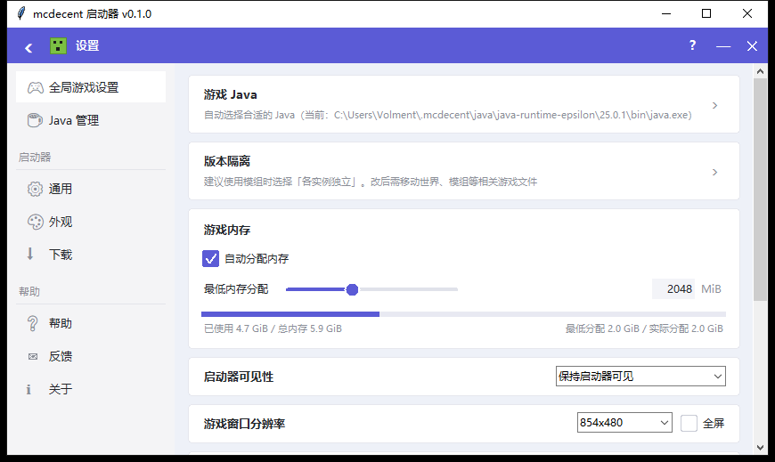
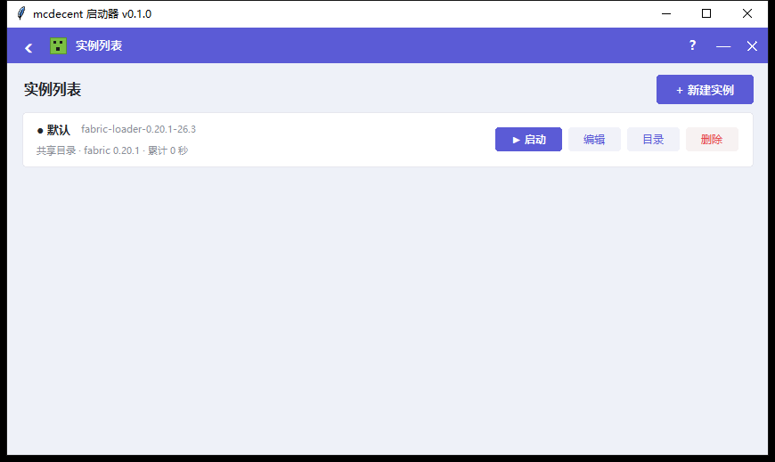
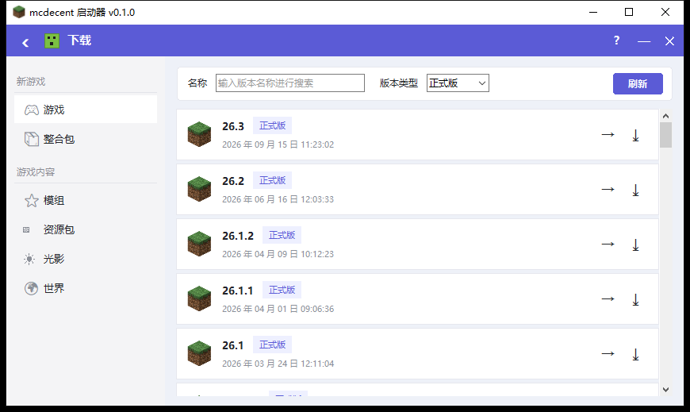

# mcdecent

**去中心化 Minecraft 命令行启动器** —— 内容寻址 + P2P 分发 + 多镜像回退，能装模组、能发整合包、能离线复用。

只用 Python 标准库（3.10+），不需要预装 Java：第一次装游戏时会自动获取与版本匹配的官方 Java 运行时。

```
mcdecent install 26.3 --loader fabric     # 原版 + Fabric 加载器
mcdecent mods install fabric-api          # 从 Modrinth 装模组（自动校验哈希）
mcdecent launch                           # 启动
```

---

## 1. 它"去中心化"在哪

Minecraft 生态的启动器几乎都依赖单一中心：官方 launcher 依赖 Mojang，各种第三方启动器依赖自己的 API。
mcdecent 把"依赖"拆成三层，任何一层挂掉都不影响使用：

| 层次 | 做法 | 效果 |
| --- | --- | --- |
| **多镜像回退** | 同一文件同时配置官方源 + 社区镜像（BMCLAPI 等），按顺序尝试，摘要不符自动换源 | 官方源被墙/抽风时仍能下载 |
| **内容寻址存储（CAS）** | 模组、整合包清单、可分发内容全部以自身 SHA-256 命名，存 `~/.mcdecent/cas/objects/sha256/` | 地址即校验和；任何副本可互换；知道哈希就能从任何持有者获取 |
| **P2P 节点** | 每个启动器实例都能跑 `peer serve`，把本地 CAS 只读共享出去；UDP 多播自动发现局域网节点；整合包清单可带 Ed25519 签名 | 无中心服务器分发整合包；断网、无镜像也能从邻居机器拉取 |

此外还有"本地优先"：所有已下载且校验通过的文件绝不重复下载，断网时用缓存元数据也能启动已装好的版本。

## 2. 安装 / 环境要求

- Windows / Linux / macOS，Python 3.10+（项目本身零第三方依赖）
- 无需预装 Java：`install` 会按版本 JSON 里的 `javaVersion` 自动下载官方运行时到 `~/.mcdecent/java/`，不污染系统环境
- 磁盘：一个现代版本全量约 1.2 GB（客户端 41 MB + 库 70 MB + 资源 460 MB + Java 100 MB，LZMA 压缩后实际下载约 600 MB）

```powershell
cd C:\MC
python -m mcdecent doctor                  # 体检：目录/磁盘/镜像/Java/网络
python -m mcdecent install 26.3            # 装最新正式版（含 Java 与全部资源）
python -m mcdecent launch --dry-run        # 只打印启动命令，先确认
python -m mcdecent launch                  # 真正启动
```

也可以把 `mcdecent.cmd` 所在目录加入 PATH，之后直接用 `mcdecent ...`；或 `pip install -e .` 安装 `mcdecent` 命令。

### 图形界面（双击即用，无需命令行）

已经用 PyInstaller 打包成窗口程序：

```text
C:\MC\dist\mcdecent\mcdecent.exe      # 双击即可，无控制台窗口
```

已创建桌面快捷方式「mcdecent 启动器」；`dist\mcdecent` 整个目录约 27 MB，可以整体拷到别的机器（便携版，数据仍在 `~/.mcdecent`）。

窗口为**无边框模式**：只保留紫色顶栏（可拖动窗口、双击最大化，右侧 ?/—/×），没有原生白色标题栏；右下角有缩放把手。exe/任务栏图标来自桌面 `3.jpeg`（已去掉白边）。

界面**按 HMCL 3.15.2 的布局复刻**（直接运行桌面上的 HMCL 截图逐页对照）：原生标题栏 + 紫色顶栏（返回/图标/标题/帮助/最小化/关闭）、左侧分组导航、右下角「开始游戏」分体按钮、设置页卡片列表。

| 页面 | 功能（对齐 HMCL） |
| --- | --- |
| 首页 | 左侧导航（账户 / 实例管理 / 实例列表 / 下载 / 设置 / 多人联机 / 官方群组）+ 背景 + 右下角「开始游戏」（▲ 可切换实例） |
| 账户列表 | 添加账户（微软账户 / 离线模式 / 外置登录）+ 已添加账户列表、切换、删除 |
| 实例列表 | 实例行（名称/版本/加载器/目录/累计时长）+ 新建实例、启动、编辑、目录、设为默认、删除 |
| 实例管理 | 顶部实例信息与操作 + 子页签：游戏设置 / 模组管理 / 资源包 / 光影 / 存档 / 服务器 / 整合包 |
| 下载 | 按 HMCL 3.15.2 复刻：左侧「新游戏〔游戏/整合包〕、游戏内容〔模组/资源包/光影/世界〕」；游戏页为版本卡片列表（草方块图标 + 版本号 + 正式版标签 + 发布时间 + 下载/详情）；其余五类为「游戏/下载源/名称/游戏版本/类别/排序 + 第一页/上一页/页码/下一页/最后一页 + 搜索（整合包另有安装整合包）」，进入即自动加载热门结果 |
| 设置 | 左侧分组（全局游戏设置 / Java 管理 / 启动器：通用、外观、下载 / 帮助：帮助、反馈、关于）；全局设置页为 HMCL 同款卡片：游戏 Java、版本隔离、游戏内存（自动分配 + 滑块 + 内存条）、启动器可见性、游戏窗口分辨率、查看日志、输出调试日志、进程优先级、服务器地址、高级设置 |
| 多人联机 / 官方群组 | HMCL 同位置页面（Terracotta 联机未接入，给出替代方案入口） |
| 诊断修复 | 内置在 设置 → 帮助/通用，以及启动失败自动弹窗；每个问题一键修复 |

图标与背景使用桌面图片（构建期由 `tools/prepare_assets.py` 裁掉白边/黑边后生成到 `mcdecent/assets/`）：
账户头像 / 窗口图标 = `3.jpeg`，首页与下载页背景 = `2.webp`；顶栏图标为 HMCL 风格绘制的 creeper（不再使用 1.jpeg）。

源码方式运行：`python -m mcdecent gui` 或 `pythonw gui_launcher.py`。
重新打包：`powershell -ExecutionPolicy Bypass -File C:\MC\build_exe.ps1`。







### 实例与版本隔离（对齐 HMCL）

每个「实例」= 一个游戏版本 + 一套独立的游戏目录（`mods/ saves/ resourcepacks/ shaderpacks/ config/`）。
版本文件（client jar、libraries、assets、Java）全局共享，所以多开实例不会成倍占磁盘。

```powershell
mcdecent instance list                       # 实例列表（含模组/存档数、默认标记）
mcdecent instance create "整合包 A" --version fabric-loader-0.20.1-26.3
mcdecent instance create "共享目录" --version 26.3 --no-isolate
mcdecent instance use "整合包 A"              # 设为默认
mcdecent instance info                       # 当前实例详情
mcdecent mods list --instance "整合包 A"      # 命令行也可以按实例操作
mcdecent game start --instance "整合包 A"
```

旧数据升级：第一次运行会自动生成名为「默认」的共享目录实例（game_dir 仍指向 `game/`），
之前的模组、存档、配置不会丢。新建实例默认隔离，可在「设置」里改默认值。

### 启动选项（对齐 HMCL 全局游戏设置）

| 选项 | 说明 |
| --- | --- |
| 窗口类型 | 窗口化 / 全屏 / 最大化（写 `options.txt`，不靠不存在的启动参数） |
| 快速游戏 | 启动后直接进入指定存档或服务器（`--quickPlaySingleplayer/Multiplayer/Realms`，1.20+） |
| 启动器可见性 | 保持 / 启动后最小化 / 启动后隐藏 / 隐藏并在游戏结束后重新打开 / 启动后退出 |
| 启动前命令 / 游戏结束后命令 | shell 语义，可调用外部脚本；实例还支持单独的「启动前命令」 |
| 环境变量 | 每行 `KEY=VALUE`，传给游戏进程 |
| 进程优先级 | 低 / 较低 / 正常 / 较高 / 高（Windows SetPriorityClass，Linux nice） |
| 包装命令 | 如 `optirun`，命令会变成 `optirun java …` |
| 默认隔离策略 | 隔离所有实例 / 只隔离模组实例 / 不隔离 |
| 检查游戏完整性 | 启动前比对 client/库/资源，缺失时阻止启动并提示修复 |

```powershell
mcdecent game start --window-type fullscreen --quick-play multiplayer --quick-play-value mc.example.com
mcdecent game start --env JAVA_TOOL_OPTIONS=-Dfoo=bar --priority high --wrapper optirun
mcdecent launch --quick-play singleplayer --quick-play-value 新的世界
```

界面「启动」页可直接选窗口类型与快速游戏；「设置」页配置全局默认值。

### 诊断与一键修复

启动器把常见故障做成可执行的诊断项：每个问题都有**中文原因说明、可能原因、修复动作**，
能自动修的提供「一键修复」按钮（界面）或 `mcdecent repair --fix`（命令行）：

| 问题 | 诊断 | 一键修复 |
| --- | --- | --- |
| 未安装版本 / 实例版本缺失 | 检测实例版本与 `versions/` | 自动安装对应版本 |
| 安装不完整 | `installer.installation_report` 缺失文件 | 重下缺失的客户端/库/资源（复用缓存） |
| Java 缺失或版本不符 | 解析 javaVersion 并探测本机/托管运行时 | 自动下载官方 Java 运行时 |
| 内存设置异常 | 低于 1 GB 或超过物理内存 75% | 调整为推荐值 |
| 磁盘空间不足 | 剩余 < 2 GB | 清理缓存与 7 天前日志 |
| 游戏崩溃 | 解析 `crash-reports/*.txt`：OOM、OpenGL/驱动/Sodium、模组冲突/缺依赖、Java 版本 | 加内存 / 禁用图形模组 / 禁用全部模组 / 换 Java |
| 网络或镜像不可用 | HEAD 探测官方源与镜像 | 切换镜像模式 / TLS 策略 |
| 残留 game.pid | PID 文件存在但进程已消失 | 清理 PID 文件 |
| options.txt 损坏 | 逐行校验 JSON 配置 | 备份后重建 |
| Fabric 加载器缺失 | 检查 loader 元信息与库 | 重新安装 Fabric 加载器 |

```powershell
mcdecent repair                 # 诊断并列出问题与修复方案
mcdecent repair --network       # 额外探测网络/镜像
mcdecent repair --fix           # 修复所有可自动修复的问题
mcdecent repair --issue java-missing
```


### 交互模式（推荐日常使用）

在 cmd / PowerShell 里直接运行（不带任何参数）就进入交互式提示符，之后像敲命令一样操作游戏：

```text
C:\MC> C:\MC\mcdecent.cmd

mcdecent 0.1.0 交互式启动器
数据目录：C:\Users\Volment\.mcdecent
输入 help 查看命令，exit 退出。常用：play / status / log -f / stop / mods install <slug>

mcdecent[空闲]> play                      # 后台启动游戏，立刻回到提示符
mcdecent[运行中]> status                  # PID / 版本 / 启动时间 / 日志路径
mcdecent[运行中]> log -f                  # 实时跟踪游戏日志（Ctrl+C 回到提示符）
mcdecent[运行中]> stop                    # 停止游戏
mcdecent[空闲]> mods install sodium --loader fabric --game-version 26.3
mcdecent[空闲]> exit
```

提示符会显示游戏是否在跑（`[空闲]` / `[运行中]`）。shell 里的命令与命令行子命令**完全一致**，另有短别名：

| 别名 | 等价命令 | 说明 |
| --- | --- | --- |
| `play` / `run` / `start` | `game start` | 后台启动游戏，立即返回 |
| `status` | `game status` | 查看进程与日志位置 |
| `log` | `game log` | 查看/跟踪日志 |
| `stop` | `game stop` | 停止游戏 |
| `ls` | `list` | 已安装版本 |
| `packs` / `peers` | `pack list` / `peer peers` | 整合包、P2P 节点 |

内建命令：`help`/`?`、`history`、`!n` / `!!`（重跑历史命令）、`home`、`clear`、`exit`。
也支持管道：`echo "status" | python -m mcdecent shell`，方便脚本化。


数据目录默认 `~/.mcdecent`，可用 `--home <目录>` 或环境变量 `MCDECENT_HOME` 指向别处（例如做成便携版）。

## 3. 常用命令

### 版本与启动

```powershell
mcdecent shell                      # 进入交互模式（等价于不带参数运行）
mcdecent list                       # 已安装版本（显示加载器、Java、是否完整、默认标记）
mcdecent list --available --limit 10  # 可安装版本（来自 Mojang 清单）
mcdecent info 26.3                  # 解析结果：主类、库数量、资源索引、安装完整性
mcdecent install <版本>              # 安装/修复
mcdecent install <版本> --loader fabric   # 同时装 Fabric（可加 --loader-version）
mcdecent launch [版本] [--username 名字] [--memory 4096] [--width 1280 --height 720]
mcdecent launch --dry-run           # 打印完整命令行（含 classpath 与参数切换）
mcdecent launch --detach            # 后台启动（等价于 game start）
mcdecent game start                 # 后台启动并记录 PID（可用 game stop/status/log 管理）
mcdecent game status | game stop | game log -f
```

`launch` 默认离线模式：UUID 由用户名按官方离线算法推导，不依赖认证服务器；也可以透传已有令牌：

```powershell
mcdecent launch --uuid <uuid> --access-token <token> --username <名字> --user-type msa
```

### 模组

```powershell
mcdecent loader versions 26.3                   # 列出可用的 Fabric 加载器版本
mcdecent loader install 26.3 --type fabric      # 安装加载器（会自动先装原版）
mcdecent loader list                            # 已装加载器

mcdecent mods add .\sodium.jar                  # 本地 jar：入 CAS + 放入 game/mods
mcdecent mods search sodium --loader fabric --game-version 26.3
mcdecent mods install sodium --loader fabric --game-version 26.3
mcdecent mods list                              # 名称、大小、SHA-256、启用状态
mcdecent mods disable sodium*                   # 支持通配符，改 .disabled 后缀
mcdecent mods enable sodium*
mcdecent mods rm sodium*
```

模组文件同时写入 `game/mods/` 和内容寻址存储，所以同一个模组可以被整合包、P2P 节点复用而无需重复下载。

### 整合包（内容寻址 + 可选签名）

```powershell
mcdecent pack export 我的整合包 --game-version 26.3 --include mods config
# 输出：清单文件 + 其 SHA-256（清单本身也进了 CAS，可用 mcdecent://pack/<sha256> 引用）
mcdecent pack export 我的整合包 --game-version 26.3 --sign-key <ed25519 私钥hex>
mcdecent pack list
mcdecent pack import mcdecent://pack/<sha256>
mcdecent pack import <路径或sha256> --peer 192.168.1.20:25577   # 缺失对象从邻居拉
```

清单格式（`format: mcdecent-pack/1`）：

```json
{
  "format": "mcdecent-pack/1",
  "name": "我的整合包", "version": "1.0.0", "game_version": "26.3",
  "loader": {"type": "fabric", "version": "0.20.1"},
  "author": "someone", "created": "2026-10-25T12:00:00+08:00",
  "files": [{"path": "mods/sodium.jar", "sha256": "…", "size": 123456, "urls": []}],
  "signature": {"alg": "ed25519", "public_key": "…", "sig": "…"}
}
```

导入时逐文件校验 SHA-256 并拒绝路径穿越；签名无效时默认警告，`--strict-signature` 则直接拒绝。

### P2P 节点

```powershell
# 机器 A：把自己的 CAS 共享出去（只读）
mcdecent peer serve --port 25577 --name "书房电脑"

# 机器 B：发现局域网节点 / 从节点拉取
mcdecent peer discover
mcdecent peer info
mcdecent peer pull <sha256> --peer 192.168.1.20:25577
mcdecent pack import mcdecent://pack/<sha256> --peer 192.168.1.20:25577

# 把整合包登记到本地注册表，并带签名发布
mcdecent peer publish .\我的整合包.json --sign-key <私钥hex>
```

节点协议（纯 HTTP GET，只读，无需任何中心服务）：

| 路径 | 说明 |
| --- | --- |
| `/health` | 节点身份、协议版本、对象数量 |
| `/index` | 该节点全部 CAS 对象摘要列表 + 已发布整合包 |
| `/cas/<sha256>` | 取内容（客户端必须校验摘要后才入库） |
| `/pack/<sha256>` | 取整合包清单 |
| `/peers` | 该节点认识的节点 |

局域网发现使用 UDP 多播 `239.255.77.77:25578`；多播不可用时可用 `--peer` 手动指定，功能不受影响。

### 镜像与配置

```powershell
mcdecent mirror list          # 当前镜像策略（默认 auto：镜像优先、官方兜底）
mcdecent mirror test          # 逐项 HEAD 探测可用性
mcdecent config list          # 完整配置 JSON
mcdecent config set memory_mb 4096
mcdecent config set mirror_mode only     # 只走镜像 / off 只走官方 / auto 混合
mcdecent config set player.name Steve
mcdecent config set download_workers 16
mcdecent config set tls_verify strict    # 禁止证书链降级（见"安全"一节）
```

镜像规则是"主机 → 基址+路径前缀"的映射（见 `mcdecent/config.py` 的 `DEFAULT_MIRRORS`），
所以 BMCLAPI 这类把 `libraries.minecraft.net` 变成 `/maven`、把资源文件变成 `/assets` 的镜像也能正确拼接。
下载器还会**按主机学习最佳来源**：某个镜像 429/403 时短期拉黑并自动改用官方源，下批文件不再撞限流。

### Java 运行时

```powershell
mcdecent java list             # 本机 Java + 启动器托管的运行时
mcdecent java install --major 21
mcdecent java path
mcdecent config set java.path C:\Java\jdk-21\bin\java.exe   # 强制指定
```

## 4. 目录结构

```
~/.mcdecent/
├── config.json              # 配置（镜像、内存、玩家名、P2P 端口、启动选项等）
├── instances.json           # 实例列表（默认实例、隔离策略、每实例设置）
├── instances/<实例名>/       # 隔离实例的游戏目录（mods/ saves/ resourcepacks/ shaderpacks/ config/）
├── versions/<id>/           # 版本 JSON + 客户端 jar（加载器是 inheritsFrom 的附加 JSON）
├── libraries/               # Maven 布局的库
├── assets/{indexes,objects}/# 资源索引 + 内容寻址的资源对象
├── natives/<id>/            # 解压后的原生库
├── java/                    # 启动器托管的 Java 运行时
├── cas/objects/sha256/      # 内容寻址存储：模组、整合包清单、可分发内容
├── packs/                   # 本地整合包清单 + 注册表
├── game/                    # 共享游戏目录（默认实例 / 非隔离实例）
├── backups/saves/           # 存档备份
├── peers.json               # 已知 P2P 节点
└── logs/                    # 启动器日志 + 每次游戏运行日志
```

## 5. 代码结构与数据流

```
mcdecent/
├── cli.py            命令行入口：全局参数 + 命令模块自动发现
├── shell.py          交互式 shell：别名、历史、提示符显示游戏状态
├── gui/              图形界面包（HMCL 3.15 布局复刻）
│   ├── app.py        主窗口：紫色顶栏 + 页面路由 + 后台任务
│   ├── theme.py      HMCL 配色/字体
│   ├── widgets.py    圆角卡片/按钮/开关/滑块/侧边栏/页签条/表格
│   └── pages/        页面：home / accounts / instance_list / instance_manage /
│                     download / settings / multiplayer / group
├── instances.py      实例（版本隔离）：创建/复制/重命名/删除/隔离策略/每实例路径
├── catalog.py        下载中心：Modrinth 搜索/版本/安装（模组/整合包/资源包/光影/世界）
├── resources.py      资源包 / 光影 / 存档管理（options.txt、iris.properties、level.dat）
├── servers.py        最小 NBT 编解码 + servers.dat 增删改（保留未知字段）
├── repair.py         诊断与一键修复：10 类故障检测 + 修复动作
├── commands/         每个子命令一个模块：install/launch/list/doctor/java/mirror/config/
│                     game（后台进程控制）/instance/mods/pack/loader/peer/repair/shell/gui
gui_launcher.py       图形程序入口（PyInstaller 打 exe 用，支持 --selftest）
build_exe.ps1         一键重新打包窗口程序
├── config.py         配置与目录布局、镜像定义、启动选项默认值
├── net.py            HTTP 传输：镜像回退、keep-alive、并发、边下边校验、JSON 缓存
├── util.py           哈希/原子写/安全解压/进度
├── versions.py       版本清单、inheritsFrom 合并、规则求值、Maven 路径、解析
├── installer.py      安装流水线：客户端/库/原生库/资源/日志配置/Java
├── java.py           探测本机 Java + Mojang 官方运行时 + Adoptium 兜底
├── auth.py           离线 UUID（官方离线算法）与令牌透传
├── launch.py         classpath/占位符展开、参数规则、窗口/快速游戏/环境变量/钩子
├── loaders.py        Fabric / Quilt 加载器 profile 安装
├── mods.py           mods 目录管理 + Modrinth 检索/下载
├── pack.py           整合包导出/导入（内容寻址清单 + Ed25519 签名）
├── cas.py            内容寻址存储
├── p2p.py            只读 CAS HTTP 节点、UDP 多播发现、拉取客户端
├── registry.py       本地注册表：名字→摘要→公钥
└── ed25519.py        纯标准库 RFC 8032 实现
```

`install` 的数据流：

```
Mojang version_manifest_v2.json（多镜像）
        └─> 版本 JSON（本地落盘 versions/<id>/<id>.json）
              ├─> 解析 inheritsFrom 链（原版 + Fabric profile 合并成一份等效描述）
              ├─> client jar → versions/<base>/<base>.jar
              ├─> libraries → libraries/<maven 路径>
              ├─> natives → 解压到 natives/<id>/
              ├─> assetIndex → assets/indexes/，objects → assets/objects/xx/<sha1>
              ├─> logging 配置 → assets/log_configs/
              └─> Java 运行时 → java/<component>/<version>/
```

`launch` 把版本 JSON 的 `arguments.game` / `arguments.jvm` 按占位符（`${auth_player_name}`、`${classpath}`…）
和操作系统规则展开，拼出最终命令行后 `subprocess` 启动，并把游戏输出同时写入 `logs/game-*.log`。

## 6. 安全与可靠性

- **一切下载都校验 SHA-1/SHA-256**；不匹配自动换源，连续失败则报错而不是静默使用坏文件
- **CAS 地址自校验**：P2P 拉取的内容在入库前必须与请求的摘要一致，无法投毒
- **路径安全**：解压原生库/导入整合包都拒绝 `..`、绝对路径、符号链接；P2P 节点只读
- **只读节点**：`peer serve` 只响应 GET 且路由白名单，没有任何写接口
- **TLS 降级有边界**：默认先严格校验证书；仅当系统根证书过旧（老 Windows 常见）导致链验证失败时，
  对**带 SHA 摘要校验**的内容降级重试并告警——内容完整性仍由摘要保证，篡改会被拒绝；
  `mcdecent config set tls_verify strict` 可完全禁止降级。
- **不碰系统环境**：Java 运行时与游戏文件都在 `~/.mcdecent` 内
- 所有网络请求可配置超时/重试/并发；离线时自动使用已缓存元数据

## 7. 测试

```powershell
cd C:\MC
python -m pytest -q                    # 全部单元测试（不联网）
python -m pytest -q -m network         # 需要联网的集成测试（Fabric meta / Modrinth 元数据）
python -m pytest tests/test_core.py -q # 核心层：规则求值、镜像重写、CAS、版本合并、参数展开
```

## 8. 验证记录（本机实测，2026-10-30）

| 项目 | 结果 |
| --- | --- |
| 环境 | Windows 10 1809 / Intel i3 M380 / NVIDIA GeForce 310M / Python 3.13.17 |
| 全量安装 `install 26.3` | 通过：74 个库（含 21 个 `natives-windows`）、5147 个资源对象、官方 Java 25.0.1 运行时，约 5 分钟（含镜像 429 自动切换官方源） |
| Fabric 加载器 `install 26.3 --loader fabric` | 通过：`fabric-loader-0.20.1-26.3`，81 个库、classpath 82 项全部就绪 |
| 真实启动（Fabric + fabric-api） | 通过：SDL 窗口创建成功、OpenGL 3.3 后端、Fabric 加载模组（离线模式 401 属预期） |
| 模组安装 `mods install fabric-api` | 通过：1.7 MB，SHA-1 校验后入 CAS + `game/mods/` |
| 交互式 shell | 通过：`play` 后台启动 → `status` 显示 PID → `log -f` 跟踪 → `stop` 停止；提示符随游戏状态显示 `[运行中]`/`[空闲]` |
| 图形界面（打包 exe） | 通过：PyInstaller `--windowed` 产物 `dist/mcdecent/mcdecent.exe`，HMCL 布局 8 个页面全部可加载（首页/账户/实例列表/实例管理/下载/设置/多人联机/官方群组）；内置 `--selftest` 验证冻结环境命令注册正常 |
| 实例（版本隔离） | 通过：自动生成默认共享实例；新建隔离实例/复制/重命名/删除/设为默认/切实例刷新；`instance` 命令与 GUI 共用同一份 `instances.json` |
| 下载中心 | 通过：Modrinth 搜索（模组/整合包/资源包/光影/世界）→ 安装进当前实例；28 个离线测试 + 1 个真实搜索用例 |
| 资源包 / 光影 / 存档 / 服务器 | 通过：资源包按 options.txt 启停、存档 level.dat 解析与备份/导入、servers.dat NBT 增删改；28 个测试 |
| 诊断与一键修复 | 通过：`repair` 实测检出残留 game.pid 与损坏 options.txt，给出原因与修复动作；14 个测试覆盖 OOM/渲染/模组冲突/Java/网络等分类 |
| 界面复刻 | 运行桌面 HMCL-3.15.2 逐页截图对照：原生标题栏 + 紫色顶栏（返回/图标/标题/?/—/×）、左侧分组导航（账户/游戏/通用）、右下角「开始游戏」分体按钮、设置页卡片列表（游戏 Java/版本隔离/游戏内存/可见性/分辨率/日志/优先级/服务器地址/高级设置）与截图逐项对齐 |
| 截图 | `docs/hmclstyle-*.png`（首页/账户列表/实例列表/下载/设置等，本机 1366×768、Tk 8.6） |
| Sodium 兼容性 | 本机 NVIDIA GeForce 310M（驱动 9.18）上 Sodium 0.9.3-beta 卡在 "Modifying OpenGL context"，已 `mods disable sodium*`；禁用后正常创建窗口 |
| 整合包导出（含 Ed25519 签名） | 通过：清单内容地址 `mcdecent://pack/<sha256>`，签名验证通过 |
| 双节点 P2P | 通过：A 节点 `peer serve`，B 用**全新数据目录** `peer pull` 拉取并校验模组，再用 `pack import mcdecent://... --peer` 从 A 取清单与文件、验签并还原，B 从未访问任何中心服务 |
| 测试套件 | `pytest -q` → **215 passed, 1 skipped**（跳过的是需显式启用的多播回环测试；另有 6 个 `network` 用例默认联网运行） |

## 9. 与 HMCL 功能对照

界面结构、实例隔离、下载中心、诊断修复都参考了 [HMCL](https://github.com/HMCL-dev/HMCL)（桌面上就有 `HMCL-3.15.2.exe` 可以对照）：

| 能力 | HMCL | mcdecent |
| --- | --- | --- |
| **界面布局 / 文案 / 按钮位置** | 基准 | **按 HMCL 3.15.2 截图逐页复刻**（顶栏、侧边栏分组、启动按钮、设置卡片、账户/实例/下载页结构） |
| 实例 + 版本隔离 | ✓ | ✓（共享版本文件，隔离 mods/存档/配置；支持隔离策略） |
| 下载中心（游戏/模组/整合包/资源包/光影/世界） | ✓ CurseForge + Modrinth | ✓ Modrinth（5 类项目） |
| 模组管理 / 启用禁用 | ✓ | ✓ |
| 资源包 / 光影 / 存档管理 | ✓ | ✓（pack.mcmeta、options.txt、iris.properties、level.dat、存档备份/导入） |
| 服务器列表 | ✓ | ✓（servers.dat NBT 编辑） |
| 账户：离线 / 微软登录 / 外置登录 | ✓ / ✓ / ✓ | ✓ 离线；微软与外置登录暂未实现 |
| 整合包导入导出 | ✓ | ✓（内容寻址清单 + Ed25519 签名 + P2P 分发，比 HMCL 多了去中心化） |
| 全局/实例设置（内存、JVM、游戏参数、Java） | ✓ | ✓ |
| 窗口类型 / 快速游戏 / 可见性 / 环境变量 / 优先级 / 包装命令 | ✓ | ✓ |
| 启动前 / 结束后命令 | ✓ | ✓（全局 + 实例） |
| 崩溃分析与自动修复 | ✓ | ✓ 10 类诊断 + 一键修复（Java/缺文件/内存/崩溃/模组冲突/网络/损坏配置…） |
| 主题 / 主题包 / 扩展 / 自动更新 / 多人联机 / 投影 | ✓ | ✗（Roadmap；去中心化 P2P 是本项目额外能力） |
| Forge / NeoForge / OptiFine 安装器 | ✓ | ✗（Fabric / Quilt 已支持） |
| 下载源切换（官方/镜像/代理） | ✓ | ✓（多镜像回退 + 并发 + TLS 策略） |

## 10. 已知限制 / Roadmap

- 认证：离线模式 + 令牌透传；**没有**实现 Microsoft 设备码登录与外置登录（需要 OAuth 应用/第三方认证服务）
- 加载器：Fabric / Quilt；Forge / NeoForge / OptiFine 的安装器逻辑更复杂，暂未接入
- 模组源：Modrinth（开放 API）；CurseForge 需要 API key，未接入
- 快速游戏依赖 MC 1.20+ 的原生 `--quickPlay*` 参数；更老版本请直接进游戏选择世界
- 自动更新、多人联机（Terracotta）、主题包、扩展、投影管理等 HMCL 功能未实现（见上方对照表）
- 资源包/存档/服务器列表刷新是同步操作；超大存档（数万文件）首次刷新可能 1–2 秒
- 老显卡注意：Sodium 等渲染优化模组对 OpenGL 版本/驱动要求高。本机 GeForce 310M + 2013 年驱动上 Sodium 0.9.3-beta 会卡在 "Modifying OpenGL context"，禁用即可；原版渲染正常
- 交互模式没有预装 readline，Windows 下方向键历史不可用，但提供 `history` / `!n` / `!!` 补救
- P2P 发现依赖局域网多播，跨公网需手动 `--peer`（可自行在公网主机上跑 `peer serve`）
- 整合包目前是"文件清单 + 哈希"，不含完整的世界/配置差异合并

许可证：MIT

## 贡献与许可

- 项目地址：https://github.com/Volment-67/mcdecent
- 许可证：MIT（见 `LICENSE`）
- 提交前请运行：`python -m pytest -q -m "not network"`（离线测试），联网测试用 `-m network`
- 不要提交 `~/.mcdecent` 运行数据、`dist/` 构建产物与本地配置
